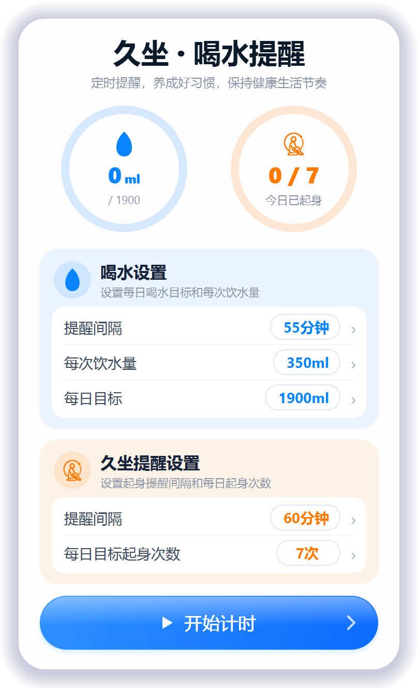
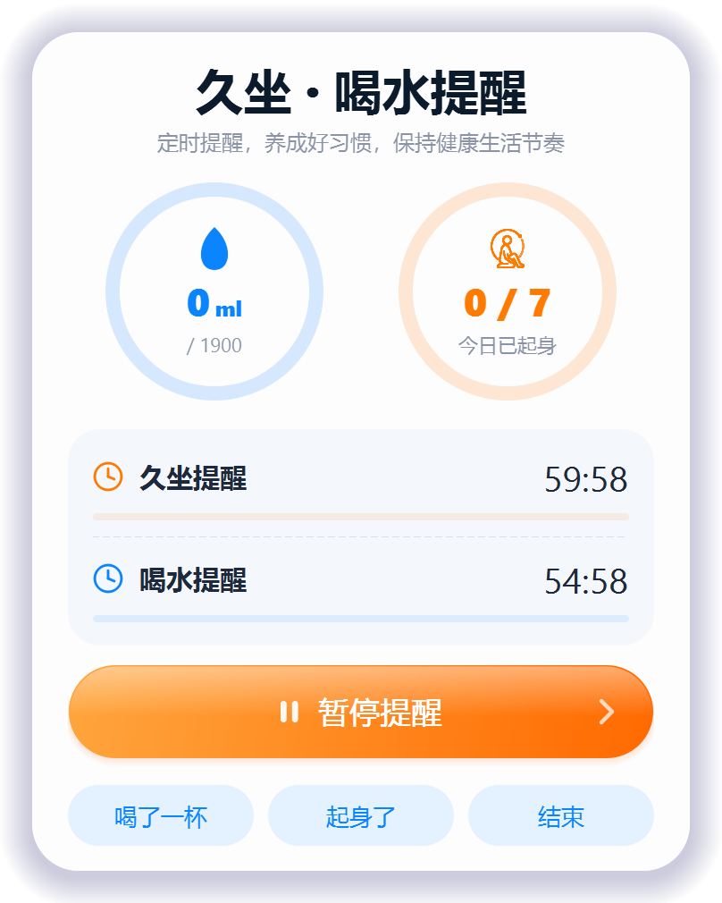
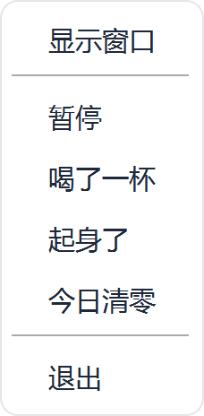
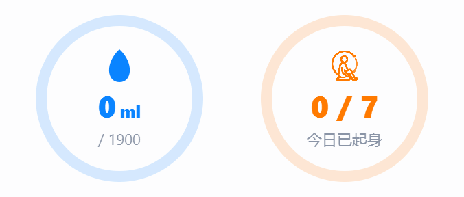

# 健康生活小助手 · Desk Health Reminder

**一个 Windows 桌面小工具：到点提醒你喝水、起来走两步，顺便把今天的进度画成两个圆环。**

不用安装、不用装 Python、不写注册表 —— 下载一个 exe，双击就能用。

---

## ⬇️ 下载

### 👉 [**点这里下载 健康生活小助手**](https://github.com/098765d/PY_healthy-life-assistant/releases/latest/download/HealthyLifeAssistant.exe)

> **直接下载地址**（复制到浏览器地址栏也能下）：
> ```
> https://github.com/098765d/PY_healthy-life-assistant/releases/latest/download/HealthyLifeAssistant.exe
> ```
> 下载下来的文件名是 `HealthyLifeAssistant.exe`，就是**健康生活小助手**本体，双击即用。
> 想手动挑版本：[**全部 Releases**](https://github.com/098765d/PY_healthy-life-assistant/releases)

| 项目 | 说明 |
| --- | --- |
| 版本 | **v0.0.11** |
| 体积 | 35.8 MB（单文件，绿色版） |
| 系统 | Windows 10 / 11（64 位） |
| 依赖 | 无。不需要装 Python、不需要运行库 |
| SHA256 | `c488a991fee71d24d09995d27b9d73472b636139589025f9a1f88f9f6978e501` |

**下载后怎么用：**

1. 把 exe 从「下载」文件夹挪到一个固定的地方，比如 `D:\软件\健康生活小助手\`（别留在下载文件夹，容易误删）
2. 双击运行
3. 第一次运行 Windows 可能弹「已保护你的电脑」—— 点 **更多信息** → **仍要运行**（软件没买数字签名，不是病毒）
4. 窗口打开、右下角托盘出现小图标 = 装好了

完整图文流程见 [**使用说明.md**](使用说明.md)。

---

## 📸 界面

<table>
<tr>
<td width="50%"><br><sub><b>待机</b>：两张设置卡，右边带描边的胶囊就是能点改的数字</sub></td>
<td width="50%"><br><sub><b>运行中</b>：两张卡换成两行倒计时，细条是本轮已过去的比例</sub></td>
</tr>
<tr>
<td><br><sub><b>操作回执</b>：右下角浮出，5 秒自动消失</sub></td>
<td><br><sub><b>托盘菜单</b>：关窗口 ≠ 退出，这里才是真退出</sub></td>
</tr>
</table>

<p align="center">
  <br>
  <sub>左环：今日已饮水 / 目标　·　右环：今日已起身次数 / 目标</sub>
</p>

---

## ✨ 做了什么

- **喝水提醒** —— 按你设的间隔，右下角浮出小卡片提醒；不抢焦点、不打断打字
- **久坐提醒** —— 坐久了提醒你起身活动，间隔自己定
- **两个进度圆环** —— 今日饮水 ml / 目标，今日起身次数 / 目标，一眼看完
- **记录喝水 / 起身** —— 窗口里点按钮，或者右键托盘，两种都行，都会回一张确认卡片
- **暂停 / 继续** —— 去开会点一下，时间停住；回来接着算，暂停时长不计入统计
- **结束生成报告** —— 点「结束」自动生成一份 HTML 报告，用浏览器打开：坐了多久、喝了多少、起来几次、几点喝的
- **绿色无污染** —— 单文件 exe，配置和记录写在 `%APPDATA%\HealthyLifeAssistant\`，删文件夹即卸载
- **不联网** —— 没有任何网络请求，没有账号，没有统计上报

---

## 🚀 三步开始用

1. **填五个数字** —— 窗口中间两张卡片，点右边带描边的胶囊就能改
   - 蓝色「喝水设置」：提醒间隔 / 每次饮水量 / 每日目标
   - 橙色「久坐提醒设置」：提醒间隔 / 每日目标起身次数
   - 输完直接生效，不用按回车
2. **点「开始计时」** —— 窗口自动收起来，右下角浮出「已隐藏在后台」，说明开始工作了
3. **该干嘛干嘛** —— 到点会提醒你。想改设置或看进度，单击托盘图标把窗口叫回来

> 「每日目标」只影响圆环画到多满，**不影响提醒频率**；提醒频率看的是「提醒间隔」。

---

## 🗂 项目结构

```
.
├── main.py                    # 全部源码（单文件，约 1650 行）
├── 健康生活小助手.spec         # PyInstaller 打包配置
├── version_info.txt           # exe 的版本资源（文件属性里看到的版本号）
├── requirements.txt           # 只有一个依赖：PyQt5
├── images/
│   ├── logo.ico               # 窗口图标 / exe 图标
│   ├── logo.png               # 高清 logo
│   └── sit_icon.png           # 久坐位的位图线稿（打包进 exe）
├── docs/                      # README 用的界面截图
├── 使用说明.md                 # 给普通用户的图文使用指南
├── 技术文档.md                 # 给开发者的实现说明
└── LICENSE
```

---

## 🛠 自己打包

需要 Python 3.11+（开发环境用的是 3.13.1）。

```bash
# 1. 装依赖
pip install -r requirements.txt

# 2. 直接跑源码
python main.py

# 3. 打包成单文件 exe（产物在 dist/）
pip install pyinstaller
pyinstaller 健康生活小助手.spec
```

打包用的是 `--onefile` + `console=False`：运行时自解压到临时目录，`sys._MEIPASS` 里找 `images/`。
`version_info.txt` 里的 `filevers` / `prodvers` 是四段式元组，发版前记得和 `FileVersion` 一起改。

---

## 📍 数据存在哪

| 内容 | 路径 |
| --- | --- |
| 设置（五个数字） | `%APPDATA%\HealthyLifeAssistant\settings.json` |
| 每日记录 | `%APPDATA%\HealthyLifeAssistant\log.csv` |
| 结束报告 | `%APPDATA%\HealthyLifeAssistant\report_YYYYMMDD.html` |

卸载：右键托盘 → 退出 → 删掉 exe 所在文件夹。想连数据一起清掉，再删 `%APPDATA%\HealthyLifeAssistant`。

---

## 📄 文档

- [**使用说明.md**](使用说明.md) —— 面向使用者：安装、三步上手、界面怎么看、提示卡片、报告、常见问题
- [**技术文档.md**](技术文档.md) —— 面向开发者：架构、计时模型、圆环布局约束、提示卡片、打包细节

---

## 🧩 关于

这个 app 是用 [WorkBuddy](https://www.workbuddy.cn) 做的 —— 我基本只动嘴描述需求，代码由 AI 写、由我验收。

<div align="center">
  <br>
  <sub><b>Built with WorkBuddy</b></sub>
</div>

---

## License

[MIT](LICENSE)
